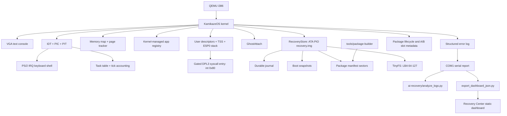

# KamikazeOS

KamikazeOS is an experimental operating system research prototype exploring
auditable self-healing infrastructure. The kernel records failures, exports
structured recovery reports, persists recovery evidence, and supports
human-approved, policy-gated recovery actions and controlled package update
flows.

It runs in QEMU as a focused research OS prototype. It is not intended to
replace Linux, Windows, or any production operating system. The goal is to
demonstrate low-level OS mechanisms, durable recovery architecture, offline
package trust tooling, and a read-only Recovery Center dashboard while keeping
all repair/update actions explicit, logged, and human-approved.

KamikazeOS is not production-ready and not a general-purpose operating system.
It has no user isolation, no networking stack, no real driver loading, and no
production security guarantees.

Current release: v2.5.0 "Privilege Boundary". It adds DPL3 user segment
descriptors, a loaded 32-bit TSS, a dedicated privilege-transition kernel
stack, and a readiness-gated DPL3 syscall entry. Actual Ring 3 execution
remains disabled.

## Feature Overview

- Bootable 32-bit x86 kernel in QEMU.
- Real x86 IDT, CPU exception stubs, legacy PIC remap, and PIT timer ticks.
- Multiboot memory map parsing and fixed 4 KiB physical page tracking.
- Bounded fixed-region kernel bump heap with allocation stats.
- Enabled 32-bit x86 paging with a validated 0-16 MiB identity map.
- DPL3-capable `int 0x80` gate with eight fixed, validated service calls;
  current callers remain in Ring 0.
- Flat DPL3 code/data descriptors and a loaded 32-bit TSS with bounded ESP0.
- Fixed kernel task records and cooperative built-in task steps.
- Fixed-sector TinyFS with bounded checksummed text files.
- Fixed kernel-managed app registry with policy-gated built-in app runs.
- VGA text console and PS/2 IRQ keyboard shell with polling fallback.
- GhostAttach device/driver recovery layer with verified fallback policy.
- Structured kernel error logs and serial boot reports.
- RecoveryMemory with CMOS fallback.
- RecoveryStore on a raw ATA PIO disk image.
- Durable journal, boot snapshots, and health scoring.
- Fixed RecoveryEngine action catalog with policy gates.
- Package lifecycle: approve, apply, verify, rollback.
- Disk-backed package manifests and persistent package state.
- A/B module slot metadata for simulated package application.
- Offline package manifest tooling with real host-side Ed25519 signatures.
- Analyzer and read-only Recovery Center dashboard.
- Integrated `system` and `diagnose` status commands for v2.x demos.

## Architecture



## Quickstart

Requirements on Windows:

```powershell
winget install LLVM.LLVM
winget install SoftwareFreedomConservancy.QEMU
winget install Python.Python.3.12
```

Build:

```powershell
.\scripts\build.ps1
```

Run the OS:

```powershell
.\scripts\run.ps1
```

Prepare a demo checklist:

```powershell
.\scripts\demo-v20.ps1
```

Analyze the captured serial report after running `export-logs` in the OS:

```powershell
python ai-recovery\analyze_logs.py build\serial.log
```

Generate dashboard data:

```powershell
python ai-recovery\export_dashboard_json.py build\serial.log recovery-center\data\recovery-report.json
```

Open:

```text
http://127.0.0.1:8080/
```

Serve the dashboard locally:

```powershell
.\scripts\generate-dashboard.ps1
```

## Demo Flow

Inside KamikazeOS:

```text
health
system
diagnose
store
snapshots
tasks
gdt
tss
privilege
ring3-readiness
syscalls
syscall-test
fs
apps
run tinyfs-demo
packages
manifests
trust
package PKG-101
approve-pkg PKG-101
apply-pkg PKG-101
verify-pkg PKG-101
export-logs
```

On the host:

```powershell
python tools\package-builder\validate_manifest.py packages\examples\PKG-101-ghostattach-policy.json
python tools\package-builder\validate_manifest.py packages\examples\PKG-199-blocked-driver-canary.json
python ai-recovery\analyze_logs.py build\serial.log
python ai-recovery\export_dashboard_json.py build\serial.log recovery-center\data\recovery-report.json
```

See [docs/DEMO_GUIDE.md](docs/DEMO_GUIDE.md) and
[docs/demo-script.md](docs/demo-script.md) for the public demo flow.

## Screenshots

Recommended screenshots are listed in
[docs/SCREENSHOT_CHECKLIST.md](docs/SCREENSHOT_CHECKLIST.md). Existing
historical screenshots live under [docs/screenshots](docs/screenshots).

## Real vs Simulated

Real:

- Bootable kernel, shell, VGA, keyboard, serial output.
- ATA PIO disk persistence and durable journal.
- Deterministic health snapshots and reports.
- Host-side package manifest creation, validation, import/export.
- Real host-side Ed25519 manifest signing and verification.
- Kernel-side manifest checksum, trust-anchor, and policy enforcement.
- DPL3-capable syscall gate, fixed dispatcher, registry, and reporting.
- User segment descriptors, loaded TSS, and dedicated ESP0 kernel stack.
- Read-only analyzer and Recovery Center Pro dashboard.

Simulated:

- In-kernel Ed25519 verification.
- Binary patching and real module replacement.
- Internet update fetching.
- AI auto-repair.
- Driver downloads or arbitrary package execution.
- Ring 3 syscall callers, userspace pointers, and process isolation.
- User stacks, user page mappings, ELF loading, and per-process address spaces.

## Safety Principles

- No networking.
- No arbitrary package loading.
- No binary patching or kernel self-modification.
- Unknown, unsigned, invalid, high-risk, irreversible, checksum-failing, or
  trust-failing packages are blocked.
- Analyzer and dashboard are read-only and may only recommend or copy shell
  commands.
- The kernel is the source of truth for package policy.

## Version History

- v2.5.0 "Privilege Boundary": DPL3 descriptors, TSS/ESP0 stack, and
  privilege-readiness reporting; Ring 3 execution remains disabled.
- v2.4.0 "Syscall Door": fixed kernel-internal `int 0x80` service interface.
- v2.3.0 "Paging Gate": validated identity paging, CR3, and page-fault evidence.
- v2.2.0 "Heap Seed": bounded kernel bump heap and heap reports.
- v2.1.0 "Memory Map": Multiboot memory map parsing and page tracking.
- v2.0.0 "Real Kernel Demo": integrated milestone with system diagnostics.
- v1.9.0 "Userland Spark": fixed built-in app registry and safe run command.
- v1.8.0 "TinyFS": bounded fixed-sector text file abstraction.
- v1.7.0 "Task Seed": fixed task table and cooperative scheduler skeleton.
- v1.6.0 "Kernel Discipline": IDT, CPU exceptions, PIC, PIT, and IRQ keyboard.
- v1.5.0 "Public Demo Release": stable public demo docs and helper scripts.
- v1.4.0 "Recovery Center Pro": polished read-only dashboard UI.
- v1.3.0 "Public Release": documentation, demo, release polish.
- v1.2.0 "Trust Forge": offline signing pipeline and trust metadata.
- v1.1.0 "Offline Package Manifest Tooling": host import/export tools.
- v1.0.0: disk-backed manifests, package state, A/B slot metadata.
- v0.9.0 "Controlled Burn": package lifecycle and policy gates.
- v0.8.0 "Vital Signs": boot snapshots and health scoring.
- v0.7.0 "Black Box": disk-backed RecoveryStore and durable journal.

See [docs/VERSION_HISTORY.md](docs/VERSION_HISTORY.md).

## Roadmap

- Possible future technical work: a first controlled Ring 3 transition,
  scheduler groundwork,
  real in-kernel Ed25519 verification, and richer test automation.
- Still out of scope: networking, driver downloads, binary patching, and
  autonomous repair.

## Portfolio Description

KamikazeOS is a QEMU-based experimental kernel built to demonstrate
operating-systems fundamentals, recovery-system design, update policy, offline
signing tooling, and honest AI-adjacent safety boundaries. It is deliberately
constrained: the interesting part is not that the OS can magically fix itself,
but that it can explain state, preserve evidence, reject unsafe changes, and
keep humans in control.
