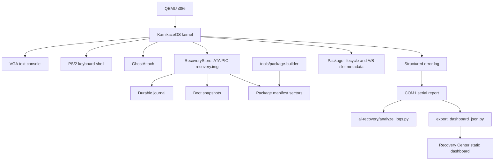

# KamikazeOS

KamikazeOS is an experimental operating system research prototype exploring
auditable self-healing infrastructure. The kernel records failures, exports
structured recovery reports, persists recovery evidence, and supports
human-approved, policy-gated recovery actions and controlled package update
flows.

It runs in QEMU as a focused research OS prototype. It is not intended to
replace Linux, Windows, or any production operating system. The goal is to
demonstrate low-level OS mechanisms, durable recovery architecture, offline
package trust tooling, and a read-only Recovery Center dashboard while keeping
all repair/update actions explicit, logged, and human-approved.

**KamikazeOS is not production-ready and not a general-purpose operating system.**
It has no production security guarantees, general process isolation, networking
stack or real driver loading.

## Current Research Status

**The research stream is v2.6.2, memory-protection Phase B.** The latest archived
Stage 2B design is **Revision 2**. Neither is a newly accepted stable release.

The code on GitHub's default `main` branch remains the older **v1.5 public demo
baseline**. This README is a documentation-only overview of the newer public
branches; those kernel changes have not been merged into `main`. Building `main`
still builds v1.5, not v2.6.2.

| Research milestone | Public source and evidence | Boundary |
| --- | --- | --- |
| v2.3-v2.5: paging, syscalls and privilege foundations | [Pre-v2.3 hardening through v2.5](https://github.com/kaamikazi/kamikazeos/tree/hardening/pre-v2.3) | Identity paging, fixed syscall interface, GDT and TSS foundations; not general userspace. |
| v2.6: Ring 3 Seed | [Ring 3 branch](https://github.com/kaamikazi/kamikazeos/tree/feature/v2.6-ring3-seed) | One fixed linked CPL3 routine completed a separately approved disposable QEMU round trip; the approval was consumed and default execution remains held. |
| v2.6.1: Integrity Gate | [Integrity hardening branch](https://github.com/kaamikazi/kamikazeos/tree/hardening/v2.6.1-integrity-gate) | Recovery, journal, snapshot, package authority and health corrections; implementation regression evidence is not independent release acceptance. |
| v2.6.2 Phase A | [Memory-layout and policy branch](https://github.com/kaamikazi/kamikazeos/tree/feature/v2.6.2-memory-protection-phase-a) | Descriptive memory policy, layout and accounting; reserved guards are not active guard pages. |
| v2.6.2 Phase B | [Emergency diagnostics branch](https://github.com/kaamikazi/kamikazeos/tree/feature/v2.6.2-memory-protection-phase-b) | Isolated fatal/DF stack preparation, bounded records and architecture checks; not complete fault-path safety acceptance. |
| Stage 2B Design Revision 2 | [Design and review archive](https://github.com/kaamikazi/kamikazeos/tree/feature/v2.6.2-memory-protection-phase-b/audit-evidence/stage2b) | Design only. A1 execution is blocked; build/RAM evidence, CMOS calibration and operational writer coverage remain incomplete. |

The latest [Revision 2 design](https://github.com/kaamikazi/kamikazeos/blob/feature/v2.6.2-memory-protection-phase-b/audit-evidence/stage2b/design-revision-2/STAGE2B_DESIGN_REVISION_2.md)
retains separate implementation, calibration, execution and review gates.
Publishing these branches does not authorize new faults, protection activation
or Ring 3 execution. Raw historical evidence is not fully included in Git;
the archive explains its scope and preservation qualifications.

## Research Feature Overview

The newer branches add to the public demo baseline:

- IDT exception handling, PIC/PIT interrupts and IRQ keyboard support.
- Multiboot memory-map validation, physical-page accounting and a bounded heap.
- Validated 32-bit identity paging with page-fault diagnostics.
- A cooperative kernel task model, fixed-sector TinyFS and built-in app registry.
- A fixed `int 0x80` syscall interface with caller-origin policy, GDT/TSS support
  and a tightly controlled historical CPL3 experiment, not general userspace.
- Recovery and package trust-boundary hardening with documented regression evidence.
- Phase B emergency diagnostics preparation, with remaining safety gates explicit.

See the [Phase B implementation and verification notes](https://github.com/kaamikazi/kamikazeos/blob/feature/v2.6.2-memory-protection-phase-b/docs/MEMORY_PROTECTION_PHASE_B.md)
for test scope, excluded cases and limitations. Those are historical receipts,
not tests rerun by this README update.

## Public Demo Baseline

The following describes the v1.5 code currently on `main`:

- Bootable 32-bit x86 kernel in QEMU.
- VGA text console and PS/2 keyboard polling shell.
- GhostAttach device/driver recovery layer with verified fallback policy.
- Structured kernel error logs and serial boot reports.
- RecoveryMemory with CMOS fallback.
- RecoveryStore on a raw ATA PIO disk image.
- Durable journal, boot snapshots, and health scoring.
- Fixed RecoveryEngine action catalog with policy gates.
- Package lifecycle: approve, apply, verify, rollback.
- Disk-backed package manifests and persistent package state.
- A/B module slot metadata for simulated package application.
- Offline package manifest tooling with real host-side Ed25519 signatures.
- Analyzer and read-only Recovery Center dashboard.

## Architecture

This diagram describes the recovery pipeline present on `main`. The newer
[architecture documentation](https://github.com/kaamikazi/kamikazeos/blob/feature/v2.6.2-memory-protection-phase-b/docs/ARCHITECTURE.md)
covers the later kernel foundations.



## Quickstart

Choose the source first. For the latest published research branch, use a
separate checkout so it does not share the older demo's recovery image:

```powershell
git clone --branch feature/v2.6.2-memory-protection-phase-b https://github.com/kaamikazi/kamikazeos.git kamikazeos-research
cd kamikazeos-research
```

A default clone without `--branch` selects the older `main` demo. Do not mix
instructions or disk images between branches without reviewing compatibility.
The commands below are the existing Windows build/run entry points; this
documentation update did not rerun them.

Requirements on Windows:

```powershell
winget install LLVM.LLVM
winget install SoftwareFreedomConservancy.QEMU
winget install Python.Python.3.12
```

Build:

```powershell
.\scripts\build.ps1
```

Run the OS:

```powershell
.\scripts\run.ps1
```

Prepare a demo checklist:

```powershell
.\scripts\demo-v15.ps1
```

Analyze the captured serial report after running `export-logs` in the OS:

```powershell
python ai-recovery\analyze_logs.py build\serial.log
```

Generate dashboard data:

```powershell
python ai-recovery\export_dashboard_json.py build\serial.log recovery-center\data\recovery-report.json
```

Open:

```text
http://127.0.0.1:8080/
```

Serve the dashboard locally:

```powershell
.\scripts\generate-dashboard.ps1
```

## Demo Flow

This is the v1.5 `main` demo flow. For later research commands and their safety
boundaries, see the [research command reference](https://github.com/kaamikazi/kamikazeos/blob/feature/v2.6.2-memory-protection-phase-b/docs/COMMAND_REFERENCE.md)
and [Ring 3 restrictions](https://github.com/kaamikazi/kamikazeos/blob/feature/v2.6.2-memory-protection-phase-b/docs/RING3.md).
Do not treat a historical experiment as permission to repeat it.

Inside KamikazeOS:

```text
health
store
snapshots
packages
manifests
trust
package PKG-101
approve-pkg PKG-101
apply-pkg PKG-101
verify-pkg PKG-101
export-logs
```

On the host:

```powershell
python tools\package-builder\validate_manifest.py packages\examples\PKG-101-ghostattach-policy.json
python tools\package-builder\validate_manifest.py packages\examples\PKG-199-blocked-driver-canary.json
python ai-recovery\analyze_logs.py build\serial.log
python ai-recovery\export_dashboard_json.py build\serial.log recovery-center\data\recovery-report.json
```

See [docs/DEMO_GUIDE.md](docs/DEMO_GUIDE.md) and
[docs/demo-script.md](docs/demo-script.md) for the public demo flow.

## Screenshots

Recommended screenshots are listed in
[docs/SCREENSHOT_CHECKLIST.md](docs/SCREENSHOT_CHECKLIST.md). Existing
historical screenshots live under [docs/screenshots](docs/screenshots).

## Real vs Simulated

Real in the public demo baseline:

- Bootable kernel, shell, VGA, keyboard, serial output.
- ATA PIO disk persistence and durable journal.
- Deterministic health snapshots and reports.
- Host-side package manifest creation, validation, import/export.
- Real host-side Ed25519 manifest signing and verification.
- Kernel-side manifest checksum, trust-anchor, and policy enforcement.
- Read-only analyzer and Recovery Center Pro dashboard.

Real kernel mechanisms on the research branches include interrupt handling,
identity paging, physical-page tracking, a bounded heap, fixed task/app tables,
TinyFS, syscall dispatch and GDT/TSS preparation. The fixed CPL3 round trip is
historical experimental evidence, not general or default user execution.

Simulated or metadata-only:

- In-kernel Ed25519 verification.
- Binary patching and real module replacement.

Not implemented or deliberately excluded:

- Networking, internet update fetching and driver/package downloads.
- AI auto-repair, automatic package application and arbitrary code execution.
- ELF loading, general userspace, per-process address spaces and process isolation.
- Active stack guard pages and newly enabled CR0.WP protection in current Phase B.
- Complete acceptance of all emergency fault paths and Stage 2B observer coverage.

## Safety Principles

- No networking.
- No arbitrary package loading.
- No binary patching or kernel self-modification.
- Unknown, unsigned, invalid, high-risk, irreversible, checksum-failing, or
  trust-failing packages are blocked.
- Analyzer and dashboard are read-only and may only recommend or copy shell
  commands.
- The kernel is the source of truth for package policy.

## Version History

- v2.6.2 (research): memory-layout/policy and emergency-diagnostic preparation;
  Stage 2B Design Revision 2 remains design-only with execution gates blocked.
- v2.6.1 "Integrity Gate" (research): recovery and package authority hardening.
- v2.6.0 "Ring 3 Seed" (research): fixed CPL3 experiment; default execution held.
- v2.5.0 "Privilege Boundary": user descriptors, TSS and readiness reporting.
- v2.4.0 "Syscall Door": fixed kernel service interface.
- v2.3.0 "Paging Gate": validated identity paging and fault diagnostics.
- v2.2.0 "Heap Seed": bounded kernel heap.
- v2.1.0 "Memory Map": physical-memory tracking.
- v2.0.0 "Real Kernel Demo": integrated system diagnostics.
- v1.9.0 "Userland Spark": kernel-managed built-in apps, not isolated userspace.
- v1.8.0 "TinyFS": fixed-sector file abstraction.
- v1.7.0 "Task Seed": cooperative kernel task skeleton.
- v1.6.0 "Kernel Discipline": interrupt and exception foundations.
- v1.5.0 "Public Demo Release": older public demo baseline still on `main`.
- v1.4.0 "Recovery Center Pro": polished read-only dashboard UI.
- v1.3.0 "Public Release": documentation, demo, release polish.
- v1.2.0 "Trust Forge": offline signing pipeline and trust metadata.
- v1.1.0 "Offline Package Manifest Tooling": host import/export tools.
- v1.0.0: disk-backed manifests, package state, A/B slot metadata.
- v0.9.0 "Controlled Burn": package lifecycle and policy gates.
- v0.8.0 "Vital Signs": boot snapshots and health scoring.
- v0.7.0 "Black Box": disk-backed RecoveryStore and durable journal.

See the [research version history](https://github.com/kaamikazi/kamikazeos/blob/feature/v2.6.2-memory-protection-phase-b/docs/VERSION_HISTORY.md)
and the [older main history](docs/VERSION_HISTORY.md). Milestone names do not
imply a newly published GitHub Release or independent safety acceptance.

## Roadmap

- Complete the outstanding Stage 2B build, RAM, CMOS and writer-observation
  evidence under separately reviewed authorization gates.
- Continue independent review before activating further memory protections or
  authorizing another controlled privilege-transition experiment.
- Potential later work includes real in-kernel Ed25519 verification and richer
  test automation; these are not implemented guarantees.
- Still out of scope: networking, driver downloads, binary patching, and
  autonomous repair.

## Portfolio Description

KamikazeOS is an experimental operating system research prototype focused on
auditable recovery architecture, kernel diagnostics, durable failure memory,
and policy-gated update safety. It demonstrates low-level x86 mechanisms,
offline trust tooling and explicit evidence/approval boundaries while keeping
its incomplete security and userspace foundations visible.
