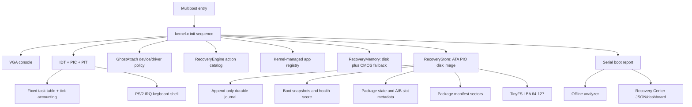

# KamikazeOS Architecture

Status: v2.3.0 "Paging Gate".

KamikazeOS is a small 32-bit x86 experimental OS research prototype that runs
in QEMU. Its architecture is organized around observability, durable recovery
state, and constrained update policy.

## Runtime Layers



## Kernel

The kernel initializes in a fixed dependency order: console, serial, error log,
recovery memory/store, IDT/PIC/PIT, task table, keyboard IRQ, GhostAttach, package metadata,
snapshots, report, and finally the shell.

Important source areas:

- `kernel/boot/boot.S`: Multiboot entry and initial stack.
- `kernel/src/kernel.c`: subsystem initialization and boot banner.
- `kernel/src/shell.c`: interactive shell commands.
- `kernel/src/errors.c`: structured error log.
- `kernel/src/idt.c`: Interrupt Descriptor Table construction and loading.
- `kernel/src/interrupt_stubs.S`: normalized CPU exception and IRQ entry stubs.
- `kernel/src/interrupts.c`: common dispatcher and exception state.
- `kernel/src/pic.c`: legacy 8259 PIC remap, masks, and EOI.
- `kernel/src/timer.c`: PIT channel 0 and tick counter.
- `kernel/src/task.c`: fixed task records and cooperative step dispatch.
- `kernel/src/tinyfs.c`: fixed-sector file metadata and bounded text I/O.
- `kernel/src/app.c`: fixed kernel-managed app registry and built-in apps.
- `kernel/src/app_policy.c`: app launch policy for compile-time entries only.
- `kernel/src/report.c`: serial report format.
- `kernel/src/ata.c`: minimal ATA PIO storage driver.
- `kernel/src/recovery_store.c`: disk-backed recovery state.
- `kernel/src/package_manifest.c`: kernel manifest loading and validation.
- `kernel/src/recovery_package.c`: package lifecycle.

## Storage Layout

The durable recovery disk is `build/recovery.img`, a 1 MiB raw image attached
to QEMU as an IDE disk. Current fixed LBA use:

| LBA range | Purpose |
|---:|---|
| 0 | Reserved; host tools must not touch it |
| 1 | RecoveryStore state block |
| 2-15 | Durable journal |
| 16-31 | Boot snapshots |
| 32-39 | Package manifest slots |
| 40-47 | Currently unused/reserved gap |
| 48 | Persistent package lifecycle primary state |
| 49 | Mirrored package transaction state |
| 50-55 | Currently unused/reserved gap |
| 56-63 | A/B module slot metadata |
| 64 | TinyFS superblock |
| 65-72 | TinyFS file table |
| 73-127 | TinyFS file data |

The layout is deliberately fixed and small so it can be audited by inspection.
Host manifest tools write only the package manifest slot range.

The ATA boundary retains the LBA28 capacity returned by IDENTIFY. Null buffers,
out-of-range sectors, device faults, and failed cache flushes are rejected.

## Package Update Model

Package application is metadata-only. The OS does not load package binaries and
does not patch kernel memory. Applying a package switches simulated module
version metadata and A/B slot metadata, then requires `verify-pkg`.

Package state at LBA 48 keeps its v1 base record and checksum. Hardened builds
use previously reserved bytes 320 onward for a separately checksummed manifest
identity, generation, and transaction sidecar, and mirror the sector at LBA 49.
The newest valid copy is selected after an interrupted write. Existing images
remain readable because a legacy LBA 48 record is still accepted. Legacy
approval-only records require fresh approval; active legacy slot transitions
are bound only when their versions reconcile with current slot metadata.

The safe flow is:

```text
package <id>
approve-pkg <id>
apply-pkg <id>
verify-pkg <id>
```

Rollback is manual:

```text
rollback-pkg <id>
```

## Host Tools

`tools/package-builder/` contains offline tools for manifest creation,
validation, signing, verification, import, and export. Host-side Ed25519
signing is real. Kernel-side Ed25519 verification is simulated and clearly
reported as such.

## Read-Only Recovery Center

The analyzer and dashboard consume serial reports. They do not talk back to the
kernel, do not write the disk image, and do not apply repairs. Their strongest
action is displaying or copying a command for a human to type into the shell.
