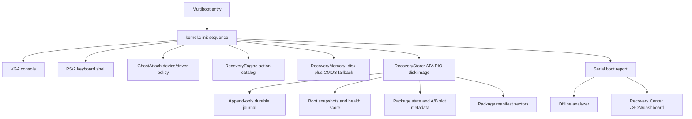

# KamikazeOS Architecture

Status: v1.3.0 "Public Release".

KamikazeOS is a small 32-bit x86 toy OS that runs in QEMU. Its architecture is
organized around observability, durable recovery state, and constrained update
policy.

## Runtime Layers



## Kernel

The kernel initializes in a fixed dependency order: console, serial, error log,
recovery memory, store, GhostAttach, package metadata, snapshots, report, and
finally the shell.

Important source areas:

- `kernel/boot/boot.S`: Multiboot entry and initial stack.
- `kernel/src/kernel.c`: subsystem initialization and boot banner.
- `kernel/src/shell.c`: interactive shell commands.
- `kernel/src/errors.c`: structured error log.
- `kernel/src/report.c`: serial report format.
- `kernel/src/ata.c`: minimal ATA PIO storage driver.
- `kernel/src/recovery_store.c`: disk-backed recovery state.
- `kernel/src/package_manifest.c`: kernel manifest loading and validation.
- `kernel/src/recovery_package.c`: package lifecycle.

## Storage Layout

The durable recovery disk is `build/recovery.img`, a 1 MiB raw image attached
to QEMU as an IDE disk. Current fixed LBA use:

| LBA range | Purpose |
|---:|---|
| 0 | Reserved; host tools must not touch it |
| 1 | RecoveryStore state block |
| 2-15 | Durable journal |
| 16-31 | Boot snapshots |
| 32-39 | Package manifest slots |
| 40-47 | Currently unused/reserved gap |
| 48-55 | Persistent package lifecycle state |
| 56-63 | A/B module slot metadata |

The layout is deliberately fixed and small so it can be audited by inspection.
Host manifest tools write only the package manifest slot range.

## Package Update Model

Package application is metadata-only. The OS does not load package binaries and
does not patch kernel memory. Applying a package switches simulated module
version metadata and A/B slot metadata, then requires `verify-pkg`.

The safe flow is:

```text
package <id>
approve-pkg <id>
apply-pkg <id>
verify-pkg <id>
```

Rollback is manual:

```text
rollback-pkg <id>
```

## Host Tools

`tools/package-builder/` contains offline tools for manifest creation,
validation, signing, verification, import, and export. Host-side Ed25519
signing is real. Kernel-side Ed25519 verification is simulated and clearly
reported as such.

## Read-Only Recovery Center

The analyzer and dashboard consume serial reports. They do not talk back to the
kernel, do not write the disk image, and do not apply repairs. Their strongest
action is displaying or copying a command for a human to type into the shell.
