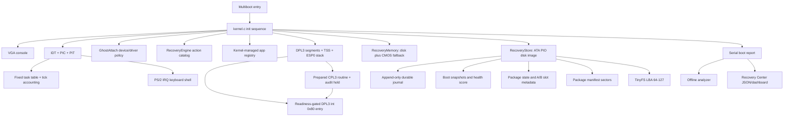

# KamikazeOS Architecture

Status: v2.6.1 "Integrity Gate"; integrity corrections pending independent review.

KamikazeOS is a small 32-bit x86 experimental OS research prototype that runs
in QEMU. Its architecture is organized around observability, durable recovery
state, and constrained update policy.

## Runtime Layers



## Kernel

The kernel initializes in a fixed dependency order: console, serial, error log,
kernel GDT, early exception IDT, TSS, recovery memory/store, memory map, heap,
validated paging and minimal user PTEs, TinyFS, PIC/PIT/IRQ gates, tasks, apps,
the syscall gate, Ring 3 readiness, keyboard IRQ, GhostAttach, package
metadata, snapshots, report, and finally the shell.

Important source areas:

- `kernel/boot/boot.S`: Multiboot entry and initial stack.
- `kernel/src/kernel.c`: subsystem initialization and boot banner.
- `kernel/src/shell.c`: interactive shell commands.
- `kernel/src/errors.c`: structured error log.
- `kernel/src/idt.c`: Interrupt Descriptor Table construction and loading.
- `kernel/src/interrupt_stubs.S`: normalized CPU exception and IRQ entry stubs.
- `kernel/src/interrupts.c`: common dispatcher and exception state.
- `kernel/src/gdt.c`: flat kernel/user descriptors and TSS descriptor.
- `kernel/src/tss.c`: 32-bit TSS and dedicated privilege-transition stack.
- `kernel/src/privilege.c`: privilege prerequisite validation and reporting.
- `kernel/src/pic.c`: legacy 8259 PIC remap, masks, and EOI.
- `kernel/src/timer.c`: PIT channel 0 and tick counter.
- `kernel/src/task.c`: fixed task records and cooperative step dispatch.
- `kernel/src/tinyfs.c`: fixed-sector file metadata and bounded text I/O.
- `kernel/src/app.c`: fixed kernel-managed app registry and built-in apps.
- `kernel/src/app_policy.c`: app launch policy for compile-time entries only.
- `kernel/src/syscall.c`: fixed syscall registry, dispatcher, and gate policy.
- `kernel/src/syscall_stub.S`: normalized `int 0x80` entry and `iret` return.
- `kernel/src/ring3.c`: final controlled-transition policy and evidence.
- `kernel/src/ring3_entry.S`: `iretd` entry, fixed CPL3 routines, and original
  Ring 0 context restoration.
- `kernel/src/report.c`: serial report format.
- `kernel/src/ata.c`: minimal ATA PIO storage driver.
- `kernel/src/recovery_store.c`: disk-backed recovery state.
- `kernel/src/package_manifest.c`: kernel manifest loading and validation.
- `kernel/src/recovery_package.c`: package lifecycle.

## Storage Layout

The durable recovery disk is `build/recovery.img`, a 1 MiB raw image attached
to QEMU as an IDE disk. Current fixed LBA use:

| LBA range | Purpose |
|---:|---|
| 0 | Reserved; host tools must not touch it |
| 1 | RecoveryStore state block |
| 2-15 | Durable journal |
| 16-31 | Boot snapshots |
| 32-39 | Package manifest slots |
| 40-47 | Currently unused/reserved gap |
| 48 | Persistent package lifecycle primary state |
| 49 | Mirrored package transaction state |
| 50 | RecoveryStore state mirror, when disk capacity exceeds 50 sectors |
| 51-55 | Currently unused/reserved gap |
| 56-63 | A/B module slot metadata |
| 64 | TinyFS superblock |
| 65-72 | TinyFS file table |
| 73-127 | TinyFS file data |

The layout is deliberately fixed and small so it can be audited by inspection.
Host manifest tools write only the package manifest slot range.

RecoveryStore uses single-copy compatibility mode on 32- and 50-sector disks.
An unreadable existing state sector remains an integrity failure. State or
journal ambiguity holds all recovery-state/journal writes and snapshot writes.
Readable journal entries supply a diagnostic boot lower bound; they never
unlock an ambiguous store. Snapshot history is also checked before selecting
its ring slot. See `STORAGE_INTEGRITY.md` for the format and ordering limits.

The ATA boundary retains the LBA28 capacity returned by IDENTIFY. Null buffers,
out-of-range sectors, device faults, and failed cache flushes are rejected.

## Package Update Model

Package application is metadata-only. The OS does not load package binaries and
does not patch kernel memory. Applying a package switches simulated module
version metadata and A/B slot metadata, then requires `verify-pkg`.

Package state at LBA 48 keeps its v1 base record and checksum. Hardened builds
use previously reserved bytes 320 onward for a separately checksummed manifest
identity, generation, and transaction sidecar, and mirror the sector at LBA 49.
The newest valid copy is selected after an interrupted write. Existing images
remain readable because a legacy LBA 48 record is still accepted. Legacy
approval-only records require fresh approval; active legacy slot transitions
are bound only when their versions reconcile with current slot metadata.

The safe flow is:

```text
package <id>
approve-pkg <id>
apply-pkg <id>
verify-pkg <id>
```

Rollback is manual:

```text
rollback-pkg <id>
```

## Host Tools

`tools/package-builder/` contains offline tools for manifest creation,
validation, signing, verification, import, and export. Host-side Ed25519
signing is real. Kernel-side Ed25519 verification is simulated and clearly
reported as such.

## Read-Only Recovery Center

The analyzer and dashboard consume serial reports. They do not talk back to the
kernel, do not write the disk image, and do not apply repairs. Their strongest
action is displaying or copying a command for a human to type into the shell.

Report records use newline-delimited sections and semicolon-delimited
`key=value` fields. Manifest validation rejects report delimiters and control
bytes in imported fields. As defense in depth, dynamic serial field values are
also sanitized by replacing `;`, `=`, and control bytes with `?`, preserving
the existing parser grammar. Host recommendations fail closed when required
policy or signature fields are missing.

The fixed GhostAttach registry includes one virtual attach-failure canary to
exercise isolation. It remains visible as `GA-TEST-201` and an expected-test
counter, but it is not classified as a production critical event and is
excluded from health penalties. A failure from any non-canary device retains
the `GA-DRV-201` critical path.

## Syscall Boundary

Vector `0x80` is installed with DPL3 only after user GDT descriptors, the TSS,
ESP0 stack, and paging validate; otherwise it remains DPL0. Calls use registers
only: EAX is the call ID,
EBX/ECX/EDX are bounded scalar or index arguments, EAX returns a result code,
and EDX returns a scalar value. Text is copied only into kernel-owned buffers.
No syscall accepts or dereferences a caller-provided pointer. v2.6 allows only
`get_ticks`, `get_health`, `system_info`, and `user_exit` from CPL3. Other
services are denied by caller origin. There are no per-process permissions or
stable userspace ABI.

## Privilege Boundary

The GDT contains flat kernel code/data descriptors, flat DPL3 code/data
descriptors, and one available 32-bit TSS descriptor. The CPU loads the TSS
with `ltr`; `ss0` selects kernel data and `esp0` points at the top of a bounded,
16 KiB dedicated privilege-transition stack. The TSS is not used for hardware
task switching.

`privilege_ready_for_ring3()` reports the architectural prerequisites. A
separate v2.6 gate also validates the fixed code/stack PTEs, supervisor-only
kernel/page structures, and the absence of broad user exposure before the
linked routine may run.

## v2.6 Ring 3 Boundary

The `ring3_enter_user()` path saves the original Ring 0 context, loads DPL3 data
selectors, and builds an `iretd` frame containing `SS=0x23`, the fixed user
stack top, `EFLAGS=0x202`, `CS=0x1B`, and a linked user EIP. The routine calls
safe scalar-only syscalls and exits through CPL3-only `SYS_USER_EXIT`. The CPU
switches to TSS `SS0:ESP0` for `int 0x80`; the exit path then restores the
saved original Ring 0 stack and returns to the shell. One approved disposable
QEMU run verified this path after hardening. Approval is consumed before
entry, and the default audited baseline is restored to
`execution_approved=no` afterward.

This is one verified trusted routine, not a loader or process model. Any
additional live CPL3 entry still requires a separately approved disposable
test build. There is no ELF,
TinyFS execution, arbitrary user code, multiple processes, per-process page
table, user/kernel copy API, stable ABI, demand paging, or guard page.
